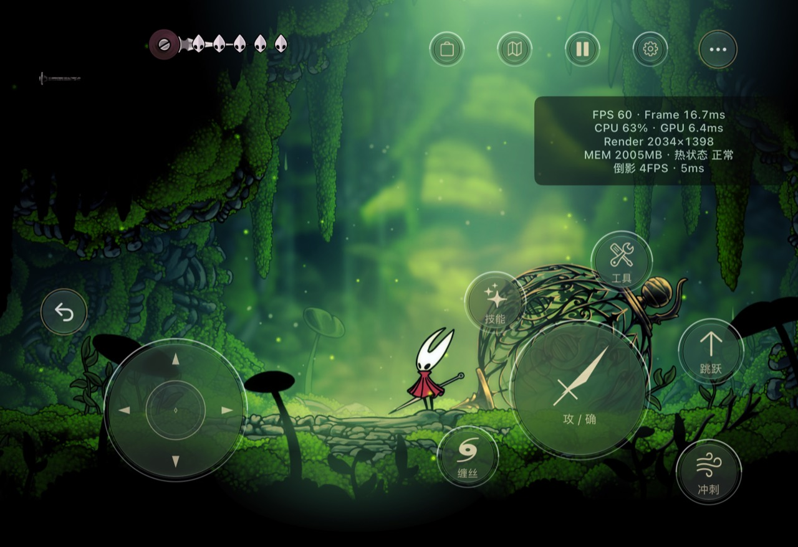
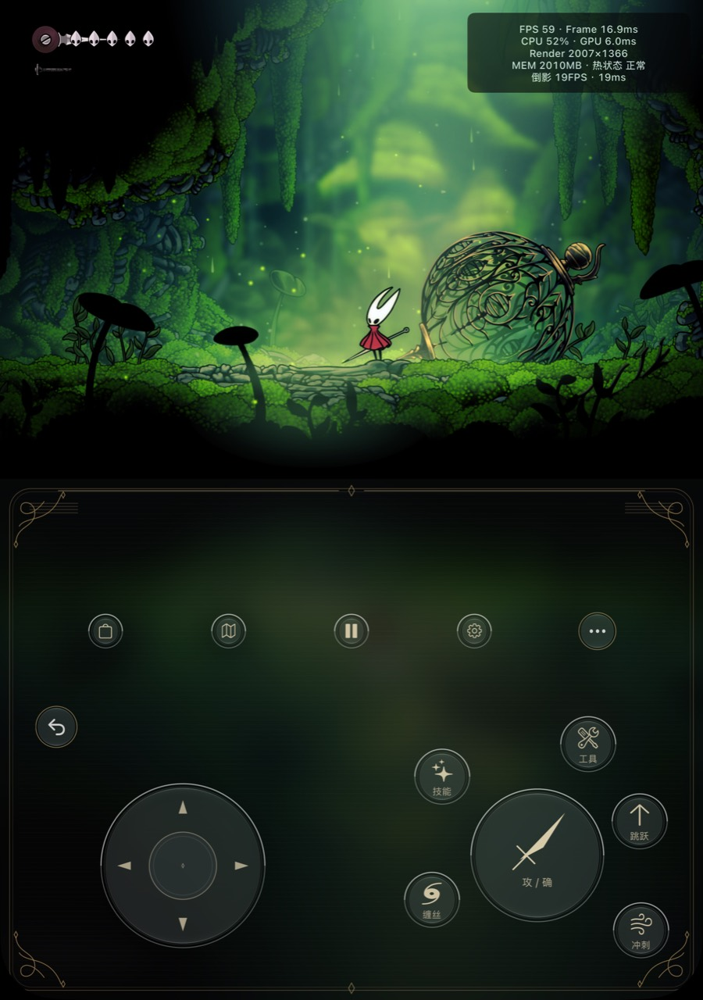

# iPhone Duo 游戏适配开发手册

**Fake Lu · Duo Adaptation Playbook**

> 一个从已有 Unity iOS IPA 出发，为折叠设备补齐窗口、画面比例、虚拟摇杆、掌机控制区和诊断功能的实际案例。当前归档版本：**0.2.19**。整理日期：**2026-11-02**。

这份仓库既是项目复盘，也是下次交给 AI 的工作记忆。先读 [AI_HANDOFF.md](AI_HANDOFF.md)，再看 [PROJECT_STATE.json](PROJECT_STATE.json) 和 [架构说明](docs/02-architecture.md)。

## 跨项目移植标准（丝之歌＋卡比）

新增 [标准方案 1.1](docs/porting-standard/README.md)：区分已有原生IPA设备适配与原始游戏文件构建，包含Duo五形态几何、错误反例、轻量反馈、CPU/GPU/内存诊断与逐项验收。复用机制，按目标游戏提取视觉元素。本目录原丝之歌源码与历史基线仍为0.2.19；跨项目指南不覆盖原工程状态。

## 最终效果

| 内屏横向 | 外屏横向 |
| --- | --- |
|  |  |

| 内屏竖向掌机 | 上下分区／半折叠样本 | 外屏竖向掌机 |
| --- | --- | --- |
|  |  |  |

截图由用户在本次收尾时提供；模式标签根据图片比例、前述测试描述推断，不等同于新增诊断 JSON。完整样本和读数见 [验证记录](docs/07-validation.md)。

## 我们实际完成了什么

- 外屏横向、外屏竖向、内屏横向、内屏竖向、半折叠：**五套独立布局**。
- 横向在画面上叠加触控；竖向采用上方游戏、下方掌机控制区；半折叠以运行时铰链区域分割上下屏。
- 保持 Unity 画面、Metal 渲染尺寸、相机与 HUD 的宽高比一致，避免“只把 UIView 拉满”的人物变形。
- 八方向摇杆、六个已有战斗动作；攻击兼确认，独立返回键；可按菜单状态精简按键，半折叠保留完整布局。
- 所有控制元素共用浮动编辑器，含返回、编辑入口、更多和监测面板；支持尺寸、透明度、显隐、横排／竖排、分形态保存。
- 下方 GPU 虚化倒影、掌机装饰、系统可用的液态玻璃、有限时长的水波和生命值反馈。
- 可移动的 FPS、CPU、GPU 耗时、实际渲染尺寸、进程内存、热状态和倒影监测。
- 可选的 Fake Lu 启动与标题标识皮肤，保留原场景加载流程。

## 范围边界：已有原生 IPA 的适配

输入是已经能在 iOS 原生运行的 `SilksongNative-0.8.2` IPA，以及独立资源包。我们没有完整 Unity 工程，也没有重建游戏本体。

因此，本项目完成的是**已有 iOS 原生构建的设备适配与交互补丁**，不是 PC／Switch 二进制的自动翻译器，也不是任意游戏的一键移植器。把别的平台游戏带到 iOS，仍需要原始工程、相应引擎／平台移植工作和可用资源链。见 [迁移到另一款游戏](docs/08-porting-another-game.md)。

“iPhone Duo”沿用用户的测试设备称呼。图示尺寸、截图与本机 SDK 是本案例依据，不作为所有设备或所有系统版本的通用规格。

## 为什么最后有效

1. **先取得真实窗口。** 单独删除全屏声明没解决旧窗口；只改 SDK 标记也不是 SDK 重建。后续加入 scene manifest、场景生命周期桥接和适配组件。
2. **再统一坐标和渲染。** 分开管理 window、gameRegion、controlsRegion、Metal pixels 和相机 viewport；处理原生分辨率路径的方向排序。
3. **最后做交互与外观。** 先稳定输入，再增加独立布局、倒影、液态玻璃、反馈和监测。
4. **每次以报告和真机结果说话。** 日志先匹配版本 UUID；源代码能编译不等于运行时 ABI 正确；截图不是长期性能基准。

## 文档导航

| 文件 | 内容 |
| --- | --- |
| [00-overview](docs/00-overview.md) | 输入、约束、原生运行与设备适配的区别 |
| [01-retrospective](docs/01-retrospective.md) | 0.2.3 → 0.2.19 的问题、试验、回退和经验 |
| [02-architecture](docs/02-architecture.md) | 窗口、渲染、输入、UI、反馈、诊断的数据流 |
| [03-geometry](docs/03-geometry.md) | 五形态、铰链、遮挡、比例、坐标转换 |
| [04-controls-and-editor](docs/04-controls-and-editor.md) | 键码、菜单策略、编辑器、持久化 |
| [05-effects-and-performance](docs/05-effects-and-performance.md) | 倒影、玻璃、反馈、各项监测的口径 |
| [06-build-and-package](docs/06-build-and-package.md) | 可复现构建、校验、打包、历史补丁入口 |
| [07-validation](docs/07-validation.md) | 截图证据、检查结果、仍未证明的内容 |
| [08-porting-another-game](docs/08-porting-another-game.md) | 有工程／只有 IPA／其他平台的三条路线 |
| [09-troubleshooting](docs/09-troubleshooting.md) | 旧窗口、拉伸、拖动禁区、崩溃和后台重启 |
| [AI_HANDOFF](AI_HANDOFF.md) | 下一次直接交给 AI 的交接文档和提示词 |
| [AGENTS](AGENTS.md) | AI 在此仓库工作时需要遵循的项目约束 |

## 快速恢复工作

环境：macOS、Xcode、Python 3；本案例使用 `iPhoneOS27.2.sdk`，编译需要目标 SDK 中存在相关接口。

```bash
python3 tools/verify.py
python3 tools/test.py
python3 tools/build.py
python3 tools/package.py \
  --baseline /absolute/path/to/verified-0.2.18-or-0.2.19.ipa \
  --bridge build/DuoSceneBridge.dylib \
  --out build/duo-next-unsigned.ipa
```

仓库不包含游戏 IPA、UnityFramework、游戏资源包、签名证书、原始崩溃日志或个人聊天。构建桥接源码不需要游戏二进制；生成可安装包需要自己保存的、身份校验通过的基线 IPA，并沿用现有签名流程。详见 [构建说明](docs/06-build-and-package.md)。

## 当前状态

收尾截图显示了 0.2.19 风格的全屏监测与玻璃控制区，游戏读数约 **59–60 FPS**，分区倒影样本约 **19–20 FPS**，热状态显示“正常”。截图中的进程内存约 **1981–2112 MB**：这是整个游戏的 footprint，不能归因于适配层。

这些静态画面支持“可以运行、布局和监测可见”的结论；不能证明全部菜单事件、受伤动画、启动动画、长期内存走势或后台恢复已经完成逐项验收。已有构建报告保留原时间点状态，新证据见 `evidence/screenshot-observations.json`。

## 再交给 AI 时

> 请先阅读 README.md、AI_HANDOFF.md、AGENTS.md 和 PROJECT_STATE.json，把 0.2.19 当作本案例当前源码。先核对本地 IPA 的 SHA-256 和引擎 UUID，再按我的新需求修改。保留已验证的画面比例、输入映射和五套布局记录；不要恢复撤回的托管触摸和 32 位 GCHandle 路径。完成后运行对应检查，生成新的报告与 unsigned IPA，并明确哪些尚需真机验证。

把仓库链接交给 AI 是恢复上下文的入口；AI 仍需实际读取这些文件，并获得本地文件／账号访问能力。这份仓库不依赖聊天服务永久记住旧对话。
