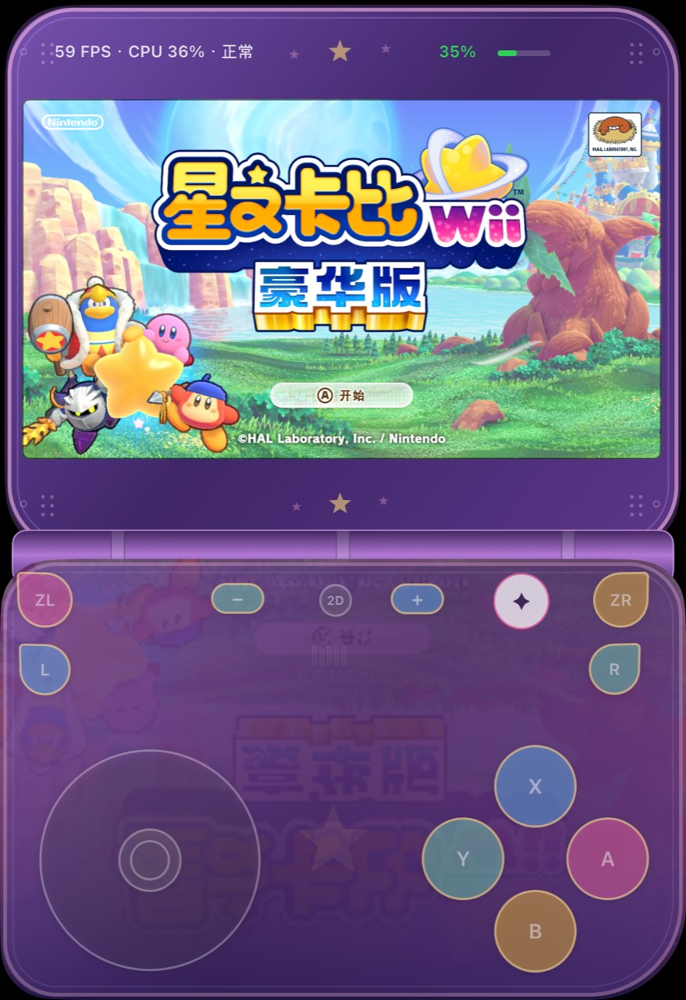
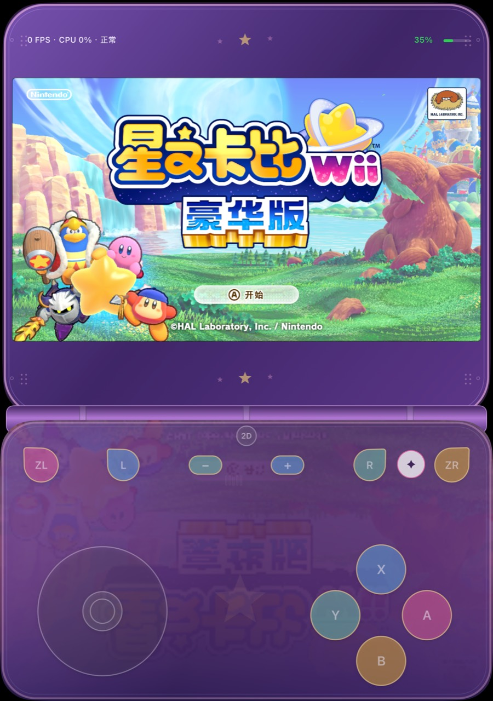
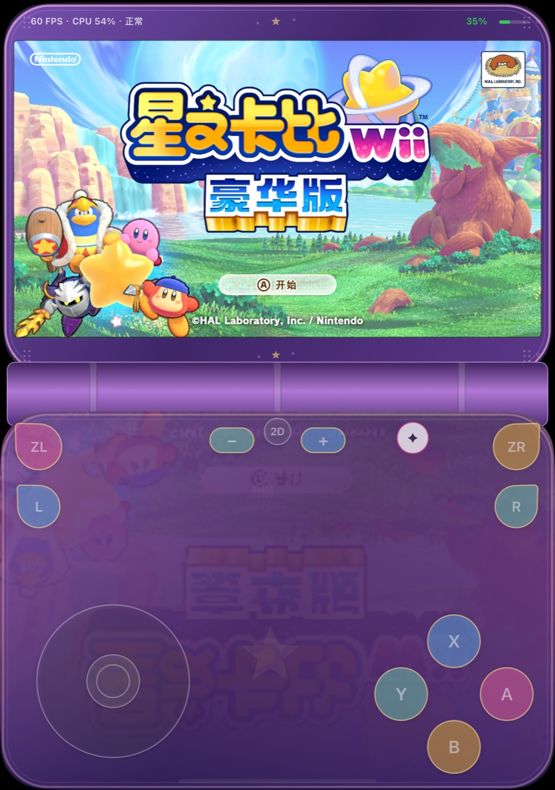
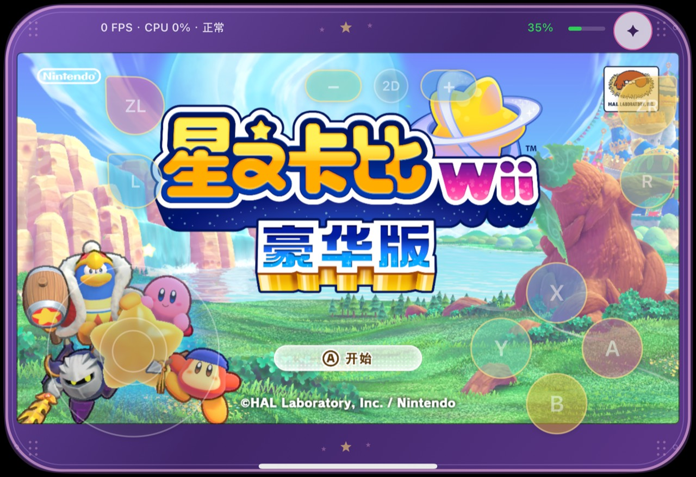
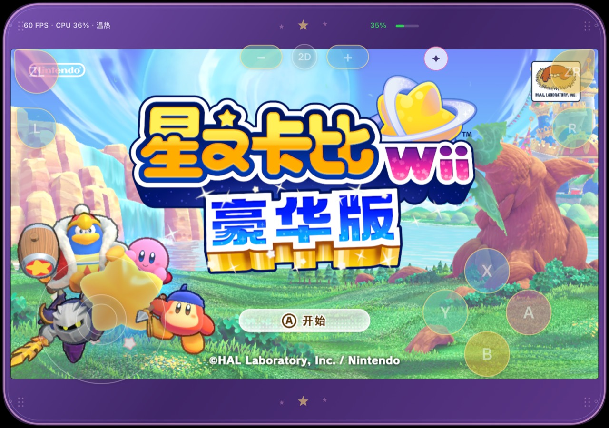
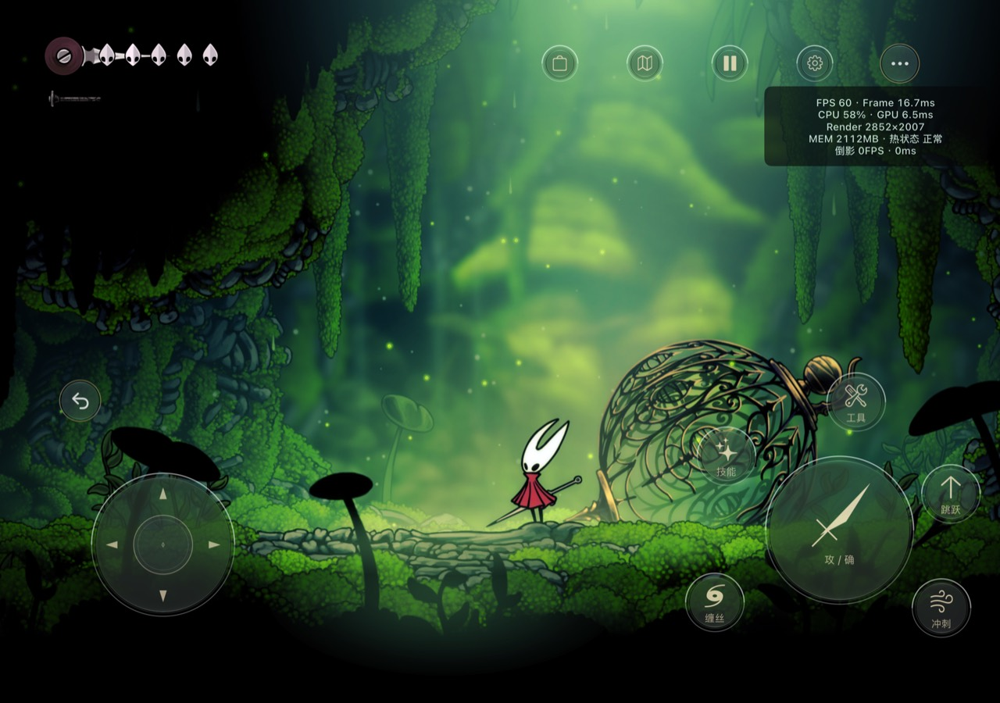
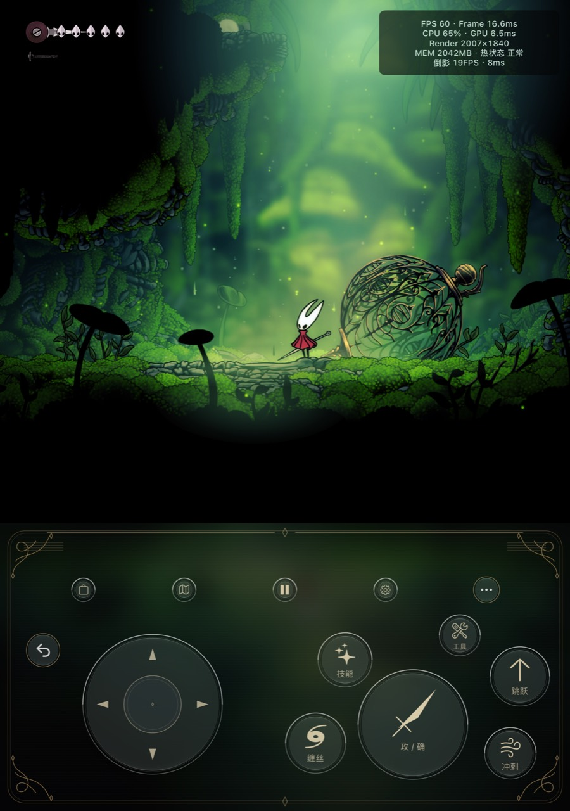
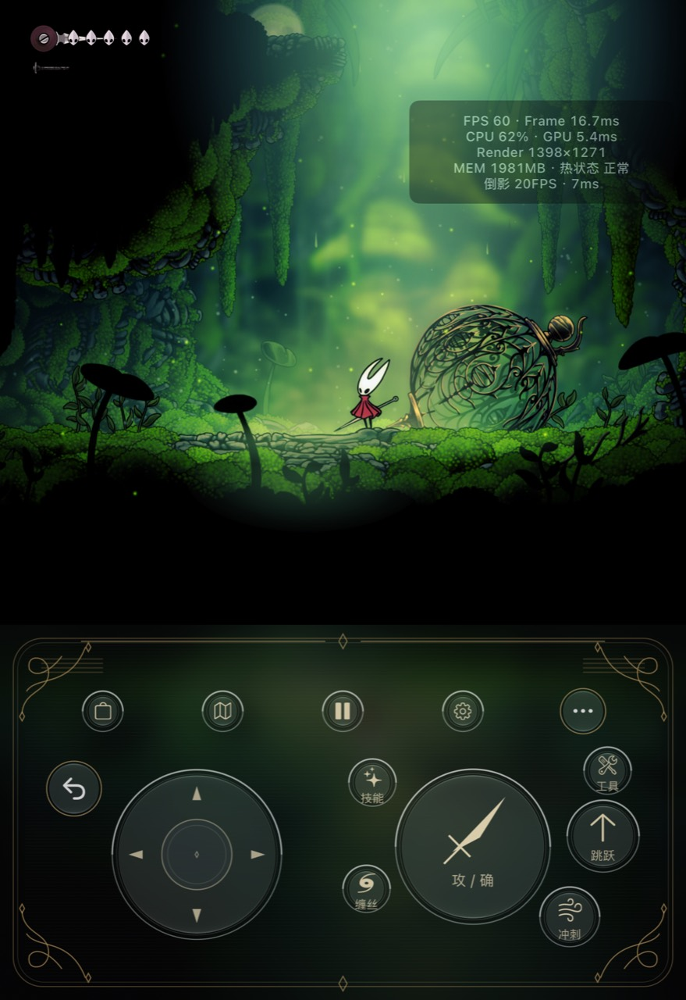

# iPhone Duo 游戏移植与适配开发手册

**Fake Lu · Duo Adaptation Playbook · 指南 1.3**

从《丝之歌》的已有原生 iOS IPA 设备适配，到《星之卡比 Wii 豪华版》的原始游戏文件构建：记录两条不同路线的正确目标、故障证据、Duo 五形态布局和可复用交互机制。

**先读 [执行标准](docs/porting-standard/STANDARD.md)，再看 [错误做法](docs/porting-standard/ANTI_PATTERNS.md)和[验收矩阵](docs/porting-standard/ACCEPTANCE.md)。** 开始新游戏时重新提取它自己的视觉元素，复用坐标、事件接口、效果预算和诊断方法。

## 引用与使用权限

允许署名引用与原样转载，禁止对外传播改编版本。原创文档采用 **CC BY-ND 4.0**；原创代码采用单独的署名原样转载许可，不作为开放修改传播的开源软件发布。游戏画面、标志与第三方内容不包含在作者授权内。[完整授权范围](LICENSE.md) · [引用格式](CITATION.md)

公开访问不会让普通访客获得修改本仓库的权限。作者已要求将仓库设为Public；实际可见性以GitHub设置为准。

## 最终效果：卡比掌机风格

以下五张为用户本轮提供的最新效果图，原图原样保留。形态标签由比例和界面分区推断，不替代运行时几何报告；截图未附包hash，不能独立确认具体二进制版本。

| 外屏竖向掌机 | 内屏竖向掌机 | 半折叠／上下分区 |
|---|---|---|
|  |  |  |

| 外屏横向叠键 | 内屏横向叠键 |
|---|---|
|  |  |

画面可见内嵌16:9游戏区、紫色掌机外壳、软件铰链、规则ABXY、下方倒影、无框监测和绿色电量横栏。这是卡比的设计语言；其他游戏不应复制同一皮肤。

图中有效非零读数为59–60 FPS、CPU 36%或54%，热状态正常／温热；两张图显示0 FPS、CPU 0%，只作计数窗口状态记录，不用于帧率或省电结论。全部是标题场景静态样本，不能验证粒子时间行为、受伤回血准确率、低延迟或长期耗电。[逐图证据](evidence/kirby-final-screenshots.json) · [验证边界](docs/07-validation.md)

## 已有案例：丝之歌玻璃风格

| 内屏横向 | 内屏竖向掌机 | 外屏竖向掌机 |
|---|---|---|
|  |  |  |

保留原有0.2.19截图、复盘、源码与发布报告。此前样本约59–60 FPS，整个应用footprint约1.98–2.11GB；不等同于适配层开销或长期性能基准。

## 两个项目的正确目标

| 项目 | 输入与目标 | 主要解决的问题 | 当前边界 |
|---|---|---|---|
| 丝之歌 | 已能在iOS运行的Unity IPA＋资源包；完成设备适配 | scene/窗口、surface与相机同步、五套布局、原动作映射、编辑器、玻璃/倒影与状态观察 | 仓库src/tools仍为0.2.19归档；本地0.2.20实验不代表已上传或已实机验证 |
| 卡比 | 原始Switch游戏文件，经nxnative构建iOS兼容宿主运行包，再适配Duo | 模块和服务bring-up、NVN→Metal资源链、内存诊断、掌机外壳、ABXY整组编辑、轻量反馈和仪表横栏 | 本仓库保存文档与用户截图，不包含卡比完整构建工程、游戏本体或密钥；v15最终包检查与真机时间行为分开记录 |

两条路线都不是任意游戏一键移植。拥有完整源码时优先正式接入目标引擎与平台。[输入路线与范围](docs/00-overview.md)

## 跨项目迁移标准

1. 核对输入、引擎/模块身份和可回退基线，再进入窗口与输入适配。
2. 运行时window、孔位、铰链为准；点、像素、pictureRect和控件坐标分开；禁止整列摄像头留黑与仅拉伸UIView。
3. 外框、背景、倒影和反馈共用圆角与裁切；必要时按角单独拟合，不能把案例尺寸当硬件通用规格。
4. 事件来源分级：真实状态、HUD识别、按键提示必须明确区分；保留置信、防抖、基线和取消机制。
5. 同条件记录帧时间、CPU/GPU口径、footprint与热状态；不以瞬时截图证明减负，不盲加sleep。
6. 确保资源身份/着色器链一致、无损去重和包完整性；编译、合成测试、真机验收分别记录。

## 文档导航

| 入口 | 内容 |
|---|---|
| [标准目录](docs/porting-standard/README.md) | 规范、反例、验收矩阵、ADR和状态模板 |
| [目标与范围](docs/00-overview.md) | 已有IPA、原始游戏文件与源码三条路线 |
| [双案例架构](docs/02-architecture.md) | 共用模块、引擎适配器与事件来源 |
| [Duo屏幕适配](docs/03-geometry.md) | 五形态、坐标、局部孔位、非对称圆角与铰链 |
| [输入与编辑](docs/04-controls-and-editor.md) | 原动作、ABXY整组、手柄与多指取消 |
| [效果与性能](docs/05-effects-and-performance.md) | 各游戏换肤、粒子预算、采样和功耗权衡 |
| [构建与资源](docs/06-build-and-package.md) | 两条独立构建链与身份校验 |
| [验证记录](docs/07-validation.md) | 新卡比截图与旧丝之歌证据边界 |
| [迁移到下一游戏](docs/08-porting-another-game.md) | 可执行阶段流程 |
| [双案例故障排查](docs/09-troubleshooting.md) | 回退、日志和错误反例 |
| [丝之歌历史复盘](docs/01-retrospective.md) | 原0.2.3→0.2.19历史保留，并链接卡比阶段记录 |
| [卡比案例](docs/cases/kirby.md) | 原始文件构建、内存修复、外壳与低延迟反馈 |
| [AI交接](AI_HANDOFF.md) | 下一次阅读顺序与恢复提示词 |

## 恢复工作

继续丝之歌0.2.19：按 [现有构建说明](docs/06-build-and-package.md) 使用tools/verify.py、tools/test.py、tools/build.py和身份校验打包器。它们不是卡比构建工具。

继续卡比或移植另一游戏：先读标准和案例，取得对应本地工程/原始输入与匹配工具链。本仓库没有提供卡比完整宿主源码，不能仅靠本仓库重建其IPA。

本手册面向社区公开展示；无游戏可执行文件、IPA、密钥、签名材料或独立资源包。用户游戏截图只用于效果和证据说明。状态见[PROJECT_STATE.json](PROJECT_STATE.json)，指南变更见[CHANGELOG.md](CHANGELOG.md)。

## 指南1.3：塔可 Select 兼容更新

新增[故障复盘与真机待验项](docs/cases/kirby-select-v16.md)、[菜单键执行标准 I02–I04](docs/porting-standard/STANDARD.md)和[针对性的实现增量与测试](code-examples/controller-select/README.md)。卡比 v16 已本地构建；完整游戏安装包和资源仍只在本地交付。
