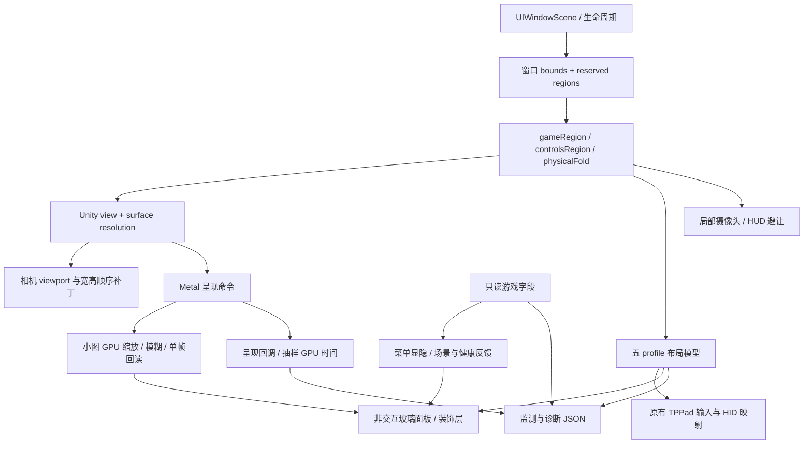

# 架构和代码地图

## 双案例复用更新 · 指南1.2

共享模块为GeometryProvider → picture/controls布局 → InputAdapter → GameStateAdapter → bounded FeedbackRenderer → Metrics。丝之歌以Unity桥接协调scene、surface、viewport；卡比以nxnative宿主、Horizon服务与NVN→Metal资源链为运行基底。状态适配器分别是经核实托管字段与试验性HUD识别，不能交换固定地址。仓库实现仍仅含丝之歌，卡比赛例见[cases/kirby.md](cases/kirby.md)。

以下保留丝之歌0.2.19原案例内容；其参数和ABI不自动适用于卡比或其他游戏。

## 六条数据链

1. **宿主窗口**：`DuoSceneDelegate` 把已有 Unity 初始化接到 scene，转发 active/background 事件。多次初始化需防重；不靠新的后台保活机制维持游戏。
2. **几何与渲染**：读取窗口实际 bounds、分割和遮挡，确定游戏区域；`SyncRenderSize` 请求目标像素并在设置改变分辨率时有限重试。
3. **游戏专用相机**：0.2.16 的有限引擎补丁使用三个 uint32 状态值 `width,height,split`，替换特定相机路径里全屏尺寸取值，分区时保留宽高顺序。
4. **输入**：保留原 `TouchControls`/`TPPad` 命中与键码，摇杆仅把已捕获的手指位置映射为八向输入；视觉层不抢触摸。
5. **装饰**：玻璃 face、倒影 UIImageView、静态蚀刻、短反馈动画。装饰不改变游戏物体命中或确认策略。
6. **观察**：只读枚举/健康/背包/场景字段；Metal 回调与系统进程信息；汇总到诊断。字段/地址都受本案例版本约束。

## 源文件对应

| 文件 | 责任 |
| --- | --- |
| `DuoSceneBridge.m` | 生命周期、区域/渲染、hook 安装、报告 |
| `LayoutModel.inc` | 控件 ID、五 profile、归一化中心、边界与排列 |
| `Editor.inc` | 可移动/折叠编辑页、尺寸透明度、监测摆位 |
| `Controls.inc` | 返回/更多、原生命中协调、菜单入口 |
| `ConsoleUI.inc` | 玻璃 face、glyph 重绘、摇杆、倒影承载层 |
| `ConsoleDrawing.h` | 静态掌机边框、刻线、针形图标等矢量绘制 |
| `HUDSafeArea.inc` | 局部摄像头对应 HUD 偏移、缓存和恢复 |
| `MetalReflection.inc` | 识别已知 Unity 呈现命令，追加捕获与回调 |
| `ReflectionGPU.inc` | MPS 缩放/模糊、纹理与 readback buffer 复用 |
| `Context.inc` | 只读元数据字段缓存、菜单/场景/生命状态 |
| `Metrics.inc` | CPU/内存/热状态、呈现 FPS 和 GPU 抽样 |
| `Feedback.inc` / `FeedbackPolicy.h` | 短水波与边缘反馈、误触发保护 |
| `Branding.inc` | 指定 logo 视觉隐藏及 Fake Lu 有限动画 |

## 可复用和不可直接搬走的部分

布局数据模型、编辑器结构、轻量视觉层、诊断字段分层可迁移。`TPPad` 方法名、键码、IL2CPP 类字段、UUID、函数地址、呈现 block 布局、引擎字节清单必须针对新游戏重新识别。

本项目没有原 `TouchControls` 完整重建工程；当前桥接重建必须依赖已带该库的匹配基线 IPA。UI bridge 不是 Unity 主工程的替代品。

## 1.4 可选副屏架构

在现有GeometryProvider/InputAdapter旁增加游戏专用SecondaryStateAdapter → 版本化不可变Snapshot → 可见页面呈现；动作反向经能力、revision与目标token校验后进入游戏原生动作。异步图像/采样使用session与generation，迟到结果丢弃。副屏信息、虚拟键和设置独立显隐。此为建议架构，未修改仓库游戏实现；详见[副屏标准](10-secondary-screen.md)。
